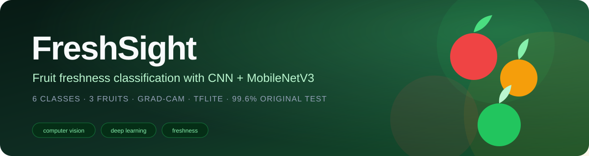
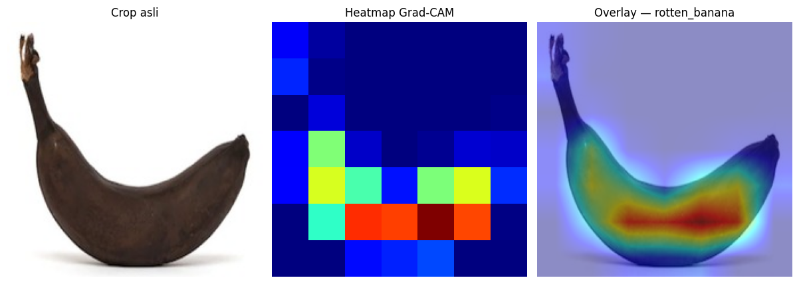
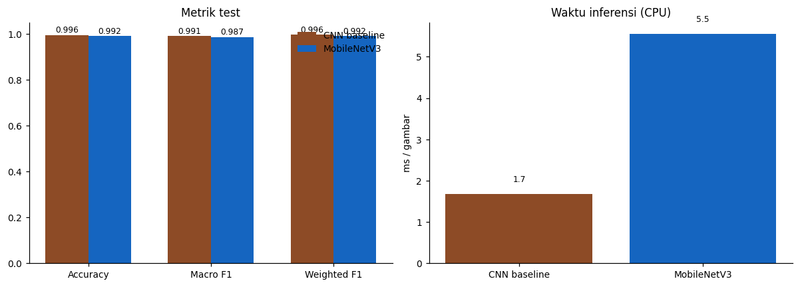
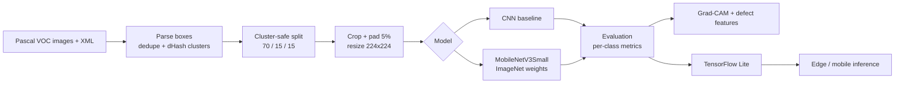

<div align="center">



# FreshSight

**Freshness classification for apples, bananas, and oranges — from a single fruit image to an explainable, deployable model.**

[](https://www.python.org/)
[](https://www.tensorflow.org/)
[](https://keras.io/)
[](https://jupyter.org/)
[](#key-results)
[](#key-results)

<a href="#overview">Overview</a> ·
<a href="#key-results">Results</a> ·
<a href="#how-it-works">How it works</a> ·
<a href="#dataset">Dataset</a> ·
<a href="#quick-start">Quick start</a> ·
<a href="#roadmap">Roadmap</a>

</div>

---

## Overview

FreshSight is an end-to-end computer-vision project for classifying fruit freshness into **six classes**:

`fresh_apple` · `rotten_apple` · `fresh_banana` · `rotten_banana` · `fresh_orange` · `rotten_orange`

The project combines:

- a **CNN baseline** trained from scratch;
- a lightweight **MobileNetV3Small** model with ImageNet transfer learning;
- **class weighting** and near-duplicate-aware splitting;
- **Grad-CAM** plus colour/texture defect features for explainability;
- **TensorFlow Lite** export for on-device inference;
- a separate, frozen evaluation protocol so external data never contaminates the test set.

> The original test set contains **997 objects**. All external data is added only to train/validation.

## Why FreshSight?

| Focus | What we do |
|---|---|
| **Not just accuracy** | Per-class precision, recall, F1, and confusion matrices expose minority-class failures. |
| **Leakage-aware evaluation** | Splits are made per near-duplicate cluster, not per image. |
| **Explainable predictions** | Grad-CAM shows where the model looks; defect features explain *why* a fruit is called rotten. |
| **Deployment-oriented** | Float32 and dynamic-range TFLite models are included. |
| **Honest external testing** | A separate 344-image external set and a 16-image Wikimedia sanity check are reported separately. |

## Key Results

| Model | Original test (997) | Macro F1 | External test (344) | Model size |
|---|---:|---:|---:|---:|
| CNN baseline | 99.60% | 0.9906 | — | 5.16 MB |
| MobileNetV3 baseline | 99.20% | 0.9871 | 62.21% | 11.84 MB |
| **MobileNetV3 + external data** | **99.60%** | **0.9912** | **90.99%** | 10.05 MB |

External-test classes: **116 fresh apple**, **109 rotten apple**, **119 rotten banana**.

**Per-class external F1**

| Class | Precision | Recall | F1 |
|---|---:|---:|---:|
| `fresh_apple` | 1.00 | 0.73 | 0.85 |
| `rotten_apple` | 0.78 | 1.00 | 0.88 |
| `rotten_banana` | 1.00 | 1.00 | 1.00 |

### TFLite deployment

| Variant | Original test | External test | Size |
|---|---:|---:|---:|
| `mobilenetv3_external_float32.tflite` | 99.60% | 91.28% | 3.74 MB |
| `mobilenetv3_external_dynamic.tflite` | 99.10% | 88.37% | 1.11 MB |

## Demo

<p align="center">
  
  
</p>

<p align="center">
  <sub>Left: Grad-CAM and defect analysis. Right: baseline vs MobileNetV3 comparison.</sub>
</p>

## How It Works



## Dataset

| Dataset | Role | Size | Link |
|---|---|---:|---|
| Fruit-freshness-detection-dataset | Main Pascal VOC data | 3,093 images / 6,977 objects | [GitHub](https://github.com/zijianchen98/Fruit-freshness-detection-dataset) |
| AFQC — Apple Fruit Quality Categorization | Apple external fine-tuning | 2,320 images | [GitHub](https://github.com/mustafa20999/AFQC) |
| Banana Images CNN — `over ripe` | Banana external fine-tuning | 1,195 images | [GitHub](https://github.com/pratheesh3780/Banana_images_CNN) |
| Orange Fruit Image Dataset | Orange next step | 15,000 images | [Mendeley](https://data.mendeley.com/datasets/zk4hzhtcdd/2) |

> **Raw datasets are not committed** to this repository because of size. The links above and the `SOURCE.md` files in the dataset folders document the source, license, and class mapping.

The main dataset is converted from nine original labels (`fresh`, `normal`, `rotten`) to six classes by merging `normal` into `fresh`. Exact duplicates and near-duplicates are handled before splitting.

## Quick Start

```bash
git clone -b freshsight-v3 https://github.com/anandra00/FreshSight.git
cd FreshSight

python -m venv .venv
# Windows:
.venv\Scripts\activate
# macOS/Linux:
# source .venv/bin/activate

pip install -r requirements.txt
jupyter notebook notebooks/FreshSight.ipynb
```

The notebook expects the Pascal VOC dataset at:

```text
materials/dataset/
├── JPEGImages/
└── Annotations/
```

or set `DATASET_DIR` to the folder that contains both directories.

### Reproduce the external-data experiment

```bash
python notebooks/finetune_external.py --prepare-only
python notebooks/finetune_external.py --epochs 6
python notebooks/evaluate_external_model.py
python notebooks/evaluate_external_tflite.py
python notebooks/evaluate_wikimedia_external.py
```

### Load the trained model

```python
import tensorflow as tf

model = tf.keras.models.load_model("models/mobilenetv3_external.keras", compile=False)
classes = [
    "fresh_apple", "rotten_apple",
    "fresh_banana", "rotten_banana",
    "fresh_orange", "rotten_orange",
]
```

## Project Structure

<details>
<summary><b>Click to expand the full tree</b></summary>

```text
FreshSight/
├── assets/
│   └── banner.svg
├── data/
│   ├── external_test/          # 16 Wikimedia sanity-check images
│   ├── crops/                  # generated crops (ignored)
│   └── crops_external/         # external 224px crops (ignored)
├── materials/
│   └── dataset/                # raw datasets (ignored)
│       ├── JPEGImages/
│       ├── Annotations/
│       ├── AFQC_apple/
│       └── Banana_overripe/
├── models/
│   ├── cnn_baseline.keras
│   ├── mobilenetv3.keras
│   ├── mobilenetv3_external.keras
│   ├── mobilenetv3_float32.tflite
│   ├── mobilenetv3_dynamic.tflite
│   ├── mobilenetv3_external_float32.tflite
│   └── mobilenetv3_external_dynamic.tflite
├── notebooks/
│   ├── FreshSight.ipynb
│   ├── finetune_external.py
│   ├── evaluate_external_model.py
│   ├── evaluate_external_tflite.py
│   ├── evaluate_wikimedia_external.py
│   └── export_external_tflite.py
├── reports/
│   ├── 01_* ... 09_*
│   └── figures/
├── .gitignore
├── PROGRESS.md
├── README.md
└── requirements.txt
```

</details>

## Experiment Notes

- Original training split: 4,871 objects; validation: 1,109; test: 997.
- External fine-tuning added **1,011 fresh apple + 1,028 rotten apple** from AFQC and **954 rotten banana** from the `over ripe` folder.
- Class imbalance changed from **12.67×** to **9.77×**; class weights were recomputed from the combined training set.
- Only `over ripe` bananas were used, so no extra `fresh_banana` was introduced.
- Test set asli **tidak diubah**; external data only entered train/validation.

## Limitations

- **Green apple / yellow apple on a green plate** remains difficult; the model has limited green-apple coverage.
- **Orange** is still under-represented; the 15k orange dataset is linked but not yet included.
- The 16-image Wikimedia set is a sanity check, not a benchmark; it is too small for statistical claims.
- The classifier handles **one crop → one label**. A pile of fruit needs a detector/multi-crop pipeline.

## Roadmap

- [x] CNN baseline + MobileNetV3 comparison
- [x] Near-duplicate-aware splitting
- [x] Grad-CAM + defect explanation
- [x] AFQC apple + overripe banana external fine-tuning
- [x] TFLite float32 + dynamic export
- [ ] Add orange fresh/rotten data (6,000 images)
- [ ] Add green apple / rotten green apple coverage
- [ ] Add plate/table/basket background augmentation
- [ ] Multi-fruit detection + per-fruit classification

## Acknowledgements

This project uses the following open datasets and resources:

- [Fruit-freshness-detection-dataset](https://github.com/zijianchen98/Fruit-freshness-detection-dataset)
- [AFQC — Apple Fruit Quality Categorization](https://github.com/mustafa20999/AFQC)
- [Banana Images CNN](https://github.com/pratheesh3780/Banana_images_CNN)
- [Orange Fruit Image Dataset for Classification](https://data.mendeley.com/datasets/zk4hzhtcdd/2)
- Wikimedia Commons images used for the 16-image external sanity check

Dataset licenses follow their respective sources. Code and notebook are part of an academic FreshSight project.

---

<div align="center">
  <sub>Built for explainable, deployable fruit-freshness classification.</sub>
</div>
