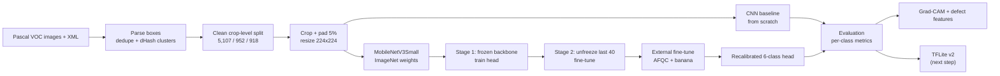

<div align="center">


# FreshSight

**Freshness classification for apples, bananas, and oranges — from a single fruit image to an explainable, deployable model.**

[](https://www.python.org/)
[](https://www.tensorflow.org/)
[](https://keras.io/)
[](https://jupyter.org/)
[](#key-results)
[](#key-results)

<a href="#overview">Overview</a> ·
<a href="#key-results">Results</a> ·
<a href="#how-it-works">How it works</a> ·
<a href="#dataset">Dataset</a> ·
<a href="#quick-start">Quick start</a> ·
<a href="#roadmap">Roadmap</a>

</div>

---

## Overview

FreshSight is an end-to-end computer-vision project for classifying fruit freshness into **six classes**:

`fresh_apple` · `rotten_apple` · `fresh_banana` · `rotten_banana` · `fresh_orange` · `rotten_orange`

The project combines:

- a **CNN baseline** trained from scratch (comparison only);
- a lightweight **MobileNetV3Small** model with **ImageNet transfer learning**;
- a clean **crop-level, near-duplicate-aware split** (no crop/source leakage);
- **external fine-tuning** on AFQC apples + overripe bananas;
- a **recalibrated 6-class head** on frozen MobileNet features for external robustness;
- **Grad-CAM** plus colour/texture defect features for explainability;
- a separate, frozen external test so external data never contaminates the test set.

> **v2 protocol:** the model is trained and evaluated on a clean crop-level split
> **5,107 train / 952 val / 918 test**, with **0 cluster leak**, **0 source-image leak**,
> and **0 test-train near-duplicates at dHash ≤ 2**. The old 997-object split and its
> 99.6% figure are kept only as historical context.

## Why FreshSight?

| Focus | What we do |
|---|---|
| **Not just accuracy** | Per-class precision, recall, F1, and confusion matrices expose minority-class failures. |
| **Leakage-aware evaluation** | Splits are made per crop cluster, source image, and old-image cluster — not per image. |
| **Transfer learning** | MobileNetV3Small starts from ImageNet weights, then is fine-tuned in two stages. |
| **External robustness** | External fine-tuning + a recalibrated head; external test is never used for fitting. |
| **Explainable predictions** | Grad-CAM shows where the model looks; defect features explain *why* a fruit is called rotten. |
| **Honest reporting** | The 344-image external test and 16-image Wikimedia sanity check are reported separately. |

## Key Results

| Model | Internal test (918) | Internal macro F1 | External test (344) | External macro F1 | Size |
|---|---:|---:|---:|---:|---:|
| Full MobileNetV3Small (10 + 15 epoch) | **99.24%** | 0.991 | 61.34% | 0.612 | 4.34 MB |
| + external fine-tune (AFQC/banana) | 88.78% | 0.843 | 95.64% | 0.955 | 10.05 MB |
| **+ recalibrated head (final)** | **98.91%** | **0.981** | **97.09%** | **0.970** | 4.33 MB |
| CNN baseline (smoke, 4 epoch) | 96.08% | 0.895 | — | — | 5.16 MB |

- Internal test: **918 crop**, 95% CI full MobileNet **98.54–99.82%**.
- External test: **344 crop** — 116 fresh apple, 109 rotten apple, 119 rotten banana.
- The final model is `models_v2/mobilenetv3small_external_recalibrated.keras`.
- The full MobileNet is `models_v2/mobilenetv3small.keras`.
- The CNN baseline full 25-epoch run was stopped; `03` and `05` remain smoke/partial.
  The full numbers are in `04` (MobileNet) and `10` (external head).

**External per-class (final head):**

| Class | Precision | Recall | F1 |
|---|---:|---:|---:|
| `fresh_apple` | 1.000 | 0.914 | 0.955 |
| `rotten_apple` | 0.916 | 1.000 | 0.956 |
| `rotten_banana` | 1.000 | 1.000 | 1.000 |

The remaining **10 external errors** are all `fresh_apple → rotten_apple`; the apple
domain/colour gap is still the main limitation.

> **Historical v1 numbers** (99.60% CNN / 99.20% MobileNet / 90.99% external) came from
> the old 997-object image-level split and are **not comparable** with the v2 clean
> crop-level results. They are kept only for context.

> **TFLite:** the v2 final head has not been exported to TFLite in this run. The
> `models/*.tflite` files are v1 artefacts and should not be mixed with the v2 tables.

## Demo

<p align="center">
  
  
</p>

<p align="center">
  <sub>Left: full MobileNetV3Small training curves. Right: clean-split confusion matrix.</sub>
</p>

## How It Works



The CNN baseline is a separate comparison model. The final model is **MobileNetV3Small
transfer learning + external fine-tuning + a linear head** — not a CNN/MobileNet ensemble.

## Dataset

| Dataset | Role | Size | Link |
|---|---|---:|---|
| Fruit-freshness-detection-dataset | Main Pascal VOC data | 3,202 images / 3,093 unique / **6,977 crops** | [GitHub](https://github.com/zijianchen98/Fruit-freshness-detection-dataset) |
| AFQC — Apple Fruit Quality Categorization | Apple external fine-tuning | 2,320 images | [GitHub](https://github.com/mustafa20999/AFQC) |
| Banana Images CNN — `over ripe` | Banana external fine-tuning | 1,195 images | [GitHub](https://github.com/pratheesh3780/Banana_images_CNN) |
| Orange Fruit Image Dataset | Orange experiment (not used in v2 final) | 15,000 images | [Mendeley](https://data.mendeley.com/datasets/zk4hzhtcdd/2) |

**Internal 6,977 crops:**

| Fruit | Fresh | Rotten | Total |
|---|---:|---:|---:|
| Apple | 1,726 | 178 | 1,904 |
| Banana | 2,248 | 778 | 3,026 |
| Orange | 1,724 | 323 | 2,047 |
| **Total** | **5,698** | **1,279** | **6,977** |

**Clean split:** train **5,107** · val **952** · test **918**. Audits: 0 cluster leak,
0 source-image leak, 0 test-train near-duplicates at dHash ≤ 2, 0 exact duplicates.

**External canonical set:** **3,456 crops** (2,993 train / 119 val / 344 test):
2,264 apple, 1,192 banana, 0 orange. Total available internal+external = **10,433 crops**;
the final head trains on **5,107 + 2,993 = 8,100** crops.

> Raw datasets are not committed because of size. `SOURCE.md` files document provenance,
> licensing, and label mapping. The 16 Wikimedia images are a sanity check, not a benchmark.

## Quick Start

```bash
git clone -b freshsight-v3 https://github.com/anandra00/FreshSight.git
cd FreshSight

python -m venv .venv
# Windows:
.venv\Scripts\activate
# macOS/Linux:
# source .venv/bin/activate

pip install -r requirements.txt
jupyter notebook notebooks/FreshSight_v2.ipynb
```

The notebook expects the Pascal VOC dataset at:

```text
materials/dataset/
├── JPEGImages/
└── Annotations/
```

or set `DATASET_DIR` to the folder that contains both directories.

### Load the final model

```python
import tensorflow as tf

model = tf.keras.models.load_model(
    "models_v2/mobilenetv3small_external_recalibrated.keras",
    compile=False,
)
classes = [
    "fresh_apple", "rotten_apple",
    "fresh_banana", "rotten_banana",
    "fresh_orange", "rotten_orange",
]
```

The full MobileNet checkpoint is `models_v2/mobilenetv3small.keras`; the external
fine-tuned checkpoint is `models_v2/mobilenetv3small_external.keras`.

## Project Structure

<details>
<summary><b>Click to expand the full tree</b></summary>

```text
FreshSight/
├── assets/
│   └── banner.svg
├── data/
│   ├── external_test/          # 16 Wikimedia sanity-check images
│   ├── crops/                  # generated crops (ignored)
│   └── crops_external/         # external crops (ignored)
├── materials/
│   └── dataset/                # raw datasets (ignored)
│       ├── JPEGImages/
│       ├── Annotations/
│       ├── AFQC_apple/
│       ├── Banana_overripe/
│       └── orange_external/
├── models/                     # v1 historical artefacts
├── models_v2/
│   ├── cnn_baseline.keras      # smoke/partial baseline (full 25 stopped)
│   ├── mobilenetv3small.keras
│   ├── mobilenetv3small_external.keras
│   └── mobilenetv3small_external_recalibrated.keras
├── notebooks/
│   ├── FreshSight_v2.ipynb     # main v2 notebook
│   ├── FreshSight.ipynb        # v1 historical notebook
│   └── ...                     # v1 external experiment scripts
├── reports/                    # v1 historical reports
├── reports_v2/
│   ├── 04_mobilenetv3_metrics.json
│   ├── 10_external_finetune.json
│   ├── 10_head_recalibration.json
│   ├── 10_*_predictions.csv
│   └── figures/
├── .gitignore
├── PROGRESS.md
├── README.md
└── requirements.txt
```

</details>

Stage checkpoints (`models_v2/*_stage*.keras`) and feature caches
(`reports_v2/*_head_features.npz`) are local/ignored.

## Experiment Notes

- **Clean internal split:** 5,107 train / 952 val / 918 test; 0 cluster/source leak.
- **Full MobileNetV3Small:** 10 epoch stage 1 + 15 epoch stage 2; internal test 99.24%,
  macro F1 0.991, 95% CI 98.54–99.82%.
- **External fine-tune:** 2,993 external train (2,544 fit + 449 holdout), external val 119;
  **850 hard fresh-apple examples** upweighted; LR 5e-5; early stopping selected epoch 1.
  External raw 95.64%; internal dropped to 88.78% (domain shift/forgetting).
- **Recalibrated head:** 6-class logistic head (C=0.1) on frozen GAP features, trained on
  internal train + external train (8,100 crops), validated on internal val + external val +
  holdout. Internal 98.91%, external 97.09%.
- **External test 344 is never used for fitting or model selection.**
- **CNN baseline:** full 25-epoch CPU run was stopped; `03`/`05` remain smoke/partial.
  `04` and `10` are the full model results.
- The v1 notebook and v1 reports are preserved for historical comparison; do not mix
  their 997-object split with the v2 clean split.

## Limitations

- **Apple domain gap:** the final head still has **10 external errors**, all fresh apple
  predicted as rotten apple. The audit shows fresh on-tree apples with pale/pink colour,
  small/occluded fruit, and different lighting — more diverse fresh-apple data is needed.
- **External test scope:** the 344-image external test contains apples and bananas only;
  it has **no oranges**. Orange robustness is not proven externally.
- **Orange data:** the 15k Mendeley orange dataset is linked but not used in the v2 final
  model; earlier orange experiments were colour-separable and are not a world benchmark.
- **CNN baseline:** full 25-epoch training was stopped; the current CNN table is smoke/
  partial and should not be presented as a full comparison.
- **TFLite:** the v2 final head has no TFLite export yet; v1 TFLite artefacts are historical.
- The 16-image Wikimedia set is a sanity check, not a benchmark; it is too small for
  statistical claims.
- The classifier handles **one crop → one label**. A pile of fruit needs a detector/
  multi-crop pipeline.

## Roadmap

- [x] Clean crop-level split with leakage audit
- [x] Full MobileNetV3Small 10 + 15 training
- [x] External fine-tune (AFQC + overripe banana)
- [x] Recalibrated 6-class head for external robustness
- [x] Per-class metrics + external error audit
- [ ] Add diverse on-tree fresh-apple data (pale/pink, occluded, different lighting)
- [ ] Add external orange training/test data
- [ ] Complete full CNN 25-epoch comparison (optional)
- [ ] Export final v2 model to TFLite
- [ ] Multi-fruit detection + per-fruit classification

## Acknowledgements

This project uses the following open datasets and resources:

- [Fruit-freshness-detection-dataset](https://github.com/zijianchen98/Fruit-freshness-detection-dataset)
- [AFQC — Apple Fruit Quality Categorization](https://github.com/mustafa20999/AFQC)
- [Banana Images CNN](https://github.com/pratheesh3780/Banana_images_CNN)
- [Orange Fruit Image Dataset for Classification](https://data.mendeley.com/datasets/zk4hzhtcdd/2)
- Wikimedia Commons images used for the 16-image external sanity check

Dataset licenses follow their respective sources. Code and notebook are part of an academic FreshSight project.

---

<div align="center">
  <sub>Built for explainable, deployable fruit-freshness classification.</sub>
</div>
