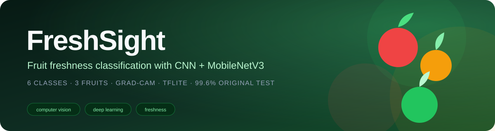
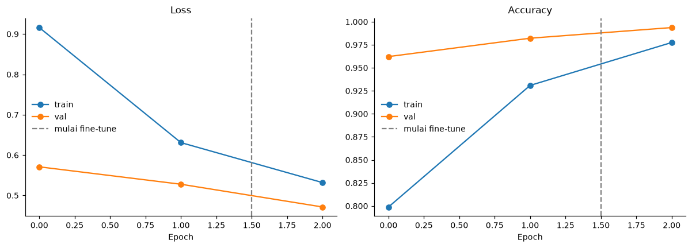
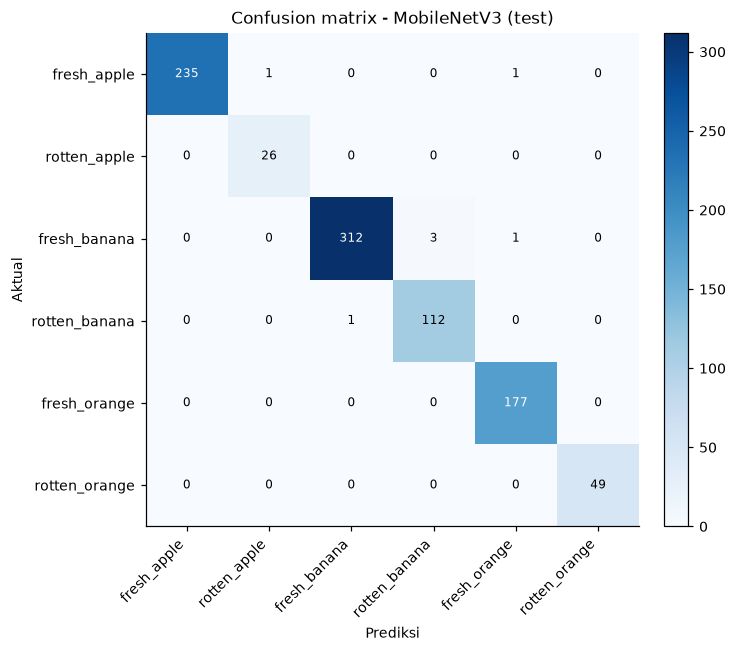
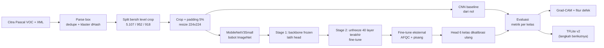

<div align="center">



# FreshSight

**Klasifikasi kesegaran apel, pisang, dan jeruk — dari satu citra buah menjadi model yang dapat dijelaskan dan siap deploy.**

[](https://www.python.org/)
[](https://www.tensorflow.org/)
[](https://keras.io/)
[](https://jupyter.org/)
[](#hasil-utama)
[](#hasil-utama)

<a href="#ringkasan">Ringkasan</a> ·
<a href="#hasil-utama">Hasil</a> ·
<a href="#cara-kerja">Cara kerja</a> ·
<a href="#dataset">Dataset</a> ·
<a href="#mulai-cepat">Mulai cepat</a> ·
<a href="#roadmap">Roadmap</a>

</div>

---

## Ringkasan

FreshSight adalah proyek computer vision end-to-end untuk mengklasifikasikan kesegaran buah menjadi **enam kelas**:

`fresh_apple` · `rotten_apple` · `fresh_banana` · `rotten_banana` · `fresh_orange` · `rotten_orange`

Proyek ini menggabungkan:

- **CNN baseline** yang dilatih dari nol (hanya pembanding);
- **MobileNetV3Small** ringan dengan **transfer learning ImageNet**;
- **split bersih level crop** yang sadar near-duplicate (tanpa kebocoran crop/sumber);
- **fine-tune eksternal** pada AFQC apel + pisang overripe;
- **head 6 kelas yang dikalibrasi ulang** di atas fitur MobileNet beku untuk ketahanan eksternal;
- **Grad-CAM** plus fitur defek warna/tekstur untuk explainability;
- test eksternal terpisah yang dibekukan, sehingga data eksternal tidak pernah mencemari test set.

> **Protokol v2:** model dilatih dan dievaluasi pada split bersih level crop
> **5.107 train / 952 val / 918 test**, dengan **0 kebocoran cluster**, **0 kebocoran
> gambar sumber**, dan **0 near-duplicate test-train pada dHash ≤ 2**. Split lama 997
> objek dan angka 99,6% hanya disimpan sebagai konteks historis.

## Mengapa FreshSight?

| Fokus | Yang kami lakukan |
|---|---|
| **Bukan hanya akurasi** | Precision, recall, F1 per kelas, dan confusion matrix memperlihatkan kegagalan kelas minoritas. |
| **Evaluasi sadar kebocoran** | Split dibuat per cluster crop, gambar sumber, dan cluster gambar lama — bukan per gambar. |
| **Transfer learning** | MobileNetV3Small dimulai dari bobot ImageNet, lalu di-fine-tune dua tahap. |
| **Ketahanan eksternal** | Fine-tune eksternal + head yang dikalibrasi ulang; test eksternal tidak pernah dipakai untuk fitting. |
| **Prediksi dapat dijelaskan** | Grad-CAM menunjukkan area yang dilihat model; fitur defek menjelaskan *mengapa* buah disebut busuk. |
| **Pelaporan jujur** | Test eksternal 344 gambar dan sanity check 16 gambar Wikimedia dilaporkan terpisah. |

## Hasil Utama

| Model | Test internal (918) | Macro F1 internal | Test eksternal (344) | Macro F1 eksternal | Ukuran |
|---|---:|---:|---:|---:|---:|
| MobileNetV3Small penuh (10 + 15 epoch) | **99,24%** | 0,991 | 61,34% | 0,612 | 4,34 MB |
| + fine-tune eksternal (AFQC/pisang) | 88,78% | 0,843 | 95,64% | 0,955 | 10,05 MB |
| **+ head dikalibrasi ulang (final)** | **98,91%** | **0,981** | **97,09%** | **0,970** | 4,33 MB |
| CNN baseline (smoke, 4 epoch) | 96,08% | 0,895 | — | — | 5,16 MB |

- Test internal: **918 crop**, 95% CI MobileNet penuh **98,54–99,82%**.
- Test eksternal: **344 crop** — 116 fresh apple, 109 rotten apple, 119 rotten banana.
- Model final: `models_v2/mobilenetv3small_external_recalibrated.keras`.
- MobileNet penuh: `models_v2/mobilenetv3small.keras`.
- **Status CNN:** kode CNN baseline tetap ada di notebook v2 dan
  `models_v2/cnn_baseline.keras` masih ada sebagai **smoke/parsial**. Full CNN 25 epoch
  **dihentikan**, jadi `03` dan `05` masih smoke. CNN **bukan bagian model final**;
  model final memakai MobileNetV3Small.

**F1 eksternal per kelas (head final):**

| Kelas | Presisi | Recall | F1 |
|---|---:|---:|---:|
| `fresh_apple` | 1,000 | 0,914 | 0,955 |
| `rotten_apple` | 0,916 | 1,000 | 0,956 |
| `rotten_banana` | 1,000 | 1,000 | 1,000 |

Sisa **10 error eksternal** semuanya `fresh_apple → rotten_apple`; gap domain/warna apel
masih menjadi keterbatasan utama.

> **Angka historis v1** (CNN 99,60% / MobileNet 99,20% / eksternal 90,99%) berasal dari
> split lama 997 objek level gambar dan **tidak sebanding** dengan hasil v2 level crop.
> Angka tersebut hanya disimpan sebagai konteks.

> **TFLite:** head final v2 belum diekspor ke TFLite pada run ini. File
> `models/*.tflite` adalah artefak v1 dan tidak boleh dicampur dengan tabel v2.

## Demo

<p align="center">
  
  
</p>

<p align="center">
  <sub>Kiri: kurva training MobileNetV3Small penuh. Kanan: confusion matrix pada split bersih.</sub>
</p>

## Cara Kerja



CNN baseline adalah model pembanding terpisah. Model final adalah **MobileNetV3Small
transfer learning + fine-tune eksternal + head linear** — bukan ensemble CNN/MobileNet.

## Dataset

| Dataset | Peran | Ukuran | Tautan |
|---|---|---:|---|
| Fruit-freshness-detection-dataset | Data utama Pascal VOC | 3.202 gambar / 3.093 unik / **6.977 crop** | [GitHub](https://github.com/zijianchen98/Fruit-freshness-detection-dataset) |
| AFQC — Apple Fruit Quality Categorization | Fine-tune eksternal apel | 2.320 gambar | [GitHub](https://github.com/mustafa20999/AFQC) |
| Banana Images CNN — `over ripe` | Fine-tune eksternal pisang | 1.195 gambar | [GitHub](https://github.com/pratheesh3780/Banana_images_CNN) |
| Orange Fruit Image Dataset | Eksperimen jeruk (tidak dipakai di v2 final) | 15.000 gambar | [Mendeley](https://data.mendeley.com/datasets/zk4hzhtcdd/2) |

**Internal 6.977 crop:**

| Buah | Segar (fresh) | Busuk (rotten) | Total |
|---|---:|---:|---:|
| Apel | 1.726 | 178 | 1.904 |
| Pisang | 2.248 | 778 | 3.026 |
| Jeruk | 1.724 | 323 | 2.047 |
| **Total** | **5.698** | **1.279** | **6.977** |

**Split bersih:** train **5.107** · val **952** · test **918**. Audit: 0 kebocoran
cluster, 0 kebocoran gambar sumber, 0 near-duplicate test-train pada dHash ≤ 2,
0 duplikat persis.

**Set eksternal kanonik:** **3.456 crop** (2.993 train / 119 val / 344 test):
2.264 apel, 1.192 pisang, 0 jeruk. Total internal+eksternal = **10.433 crop**;
head final dilatih pada **5.107 + 2.993 = 8.100** crop.

> Dataset mentah tidak di-commit karena ukurannya besar. File `SOURCE.md` mendokumentasikan
> sumber, lisensi, dan pemetaan label. 16 gambar Wikimedia adalah sanity check, bukan benchmark.

## Mulai Cepat

```bash
git clone -b freshsight-v3 https://github.com/anandra00/FreshSight.git
cd FreshSight

python -m venv .venv
# Windows:
.venv\Scripts\activate
# macOS/Linux:
# source .venv/bin/activate

pip install -r requirements.txt
jupyter notebook notebooks/FreshSight_v2.ipynb
```

Notebook mengharapkan dataset Pascal VOC di:

```text
materials/dataset/
├── JPEGImages/
└── Annotations/
```

atau set `DATASET_DIR` ke folder yang berisi kedua direktori tersebut.

### Muat model final

```python
import tensorflow as tf

model = tf.keras.models.load_model(
    "models_v2/mobilenetv3small_external_recalibrated.keras",
    compile=False,
)
classes = [
    "fresh_apple", "rotten_apple",
    "fresh_banana", "rotten_banana",
    "fresh_orange", "rotten_orange",
]
```

Checkpoint MobileNet penuh ada di `models_v2/mobilenetv3small.keras`; checkpoint
hasil fine-tune eksternal ada di `models_v2/mobilenetv3small_external.keras`.

## Struktur Proyek

<details>
<summary><b>Klik untuk membuka struktur lengkap</b></summary>

```text
FreshSight/
├── assets/
│   └── banner.svg
├── data/
│   ├── external_test/          # 16 gambar Wikimedia untuk sanity check
│   ├── crops/                  # crop hasil generate (di-ignore)
│   └── crops_external/         # crop eksternal (di-ignore)
├── materials/
│   └── dataset/                # dataset mentah (di-ignore)
│       ├── JPEGImages/
│       ├── Annotations/
│       ├── AFQC_apple/
│       ├── Banana_overripe/
│       └── orange_external/
├── models/                     # artefak historis v1
├── models_v2/
│   ├── cnn_baseline.keras      # baseline smoke/parsial (full 25 dihentikan)
│   ├── mobilenetv3small.keras
│   ├── mobilenetv3small_external.keras
│   └── mobilenetv3small_external_recalibrated.keras
├── notebooks/
│   ├── FreshSight_v2.ipynb     # notebook utama v2
│   ├── FreshSight.ipynb        # notebook historis v1
│   └── ...                     # skrip eksperimen eksternal v1
├── reports/                    # laporan historis v1
├── reports_v2/
│   ├── 04_mobilenetv3_metrics.json
│   ├── 10_external_finetune.json
│   ├── 10_head_recalibration.json
│   ├── 10_*_predictions.csv
│   └── figures/
├── .gitignore
├── PROGRESS.md
├── README.md
└── requirements.txt
```

</details>

Checkpoint stage (`models_v2/*_stage*.keras`) dan cache fitur
(`reports_v2/*_head_features.npz`) bersifat lokal/di-ignore.

## Catatan Eksperimen

- **Split internal bersih:** 5.107 train / 952 val / 918 test; 0 kebocoran cluster/sumber.
- **MobileNetV3Small penuh:** 10 epoch stage 1 + 15 epoch stage 2; test internal 99,24%,
  macro F1 0,991, 95% CI 98,54–99,82%.
- **Fine-tune eksternal:** 2.993 train eksternal (2.544 fit + 449 holdout), val eksternal 119;
  **850 contoh fresh apple sulit** di-upweight; LR 5e-5; early stopping memilih epoch 1.
  External mentah 95,64%; internal turun ke 88,78% (domain shift/forgetting).
- **Head dikalibrasi ulang:** head logistik 6 kelas (C=0,1) di fitur GAP beku, dilatih pada
  internal train + external train (8.100 crop), divalidasi pada internal val + external val +
  holdout. Internal 98,91%, eksternal 97,09%.
- **Test eksternal 344 tidak pernah dipakai untuk fitting atau pemilihan model.**
- **CNN baseline:** full 25 epoch di CPU dihentikan; `03`/`05` masih smoke/parsial.
  `04` dan `10` adalah hasil model penuh.
- Notebook v1 dan laporan v1 disimpan untuk perbandingan historis; jangan campur split
  997 objek dengan split bersih v2.

## Keterbatasan

- **Gap domain apel:** head final masih memiliki **10 error eksternal**, semuanya fresh apple
  diprediksi rotten apple. Audit menunjukkan apel segar on-tree berwarna pucat/pink, buah
  kecil/terhalang, dan pencahayaan berbeda — perlu data apel segar yang lebih beragam.
- **Cakupan test eksternal:** test eksternal 344 hanya berisi apel dan pisang; **tidak ada
  jeruk**. Ketahanan jeruk secara eksternal belum terbukti.
- **Data jeruk:** dataset Mendeley 15 ribu gambar ditautkan tetapi tidak dipakai di model
  final v2; eksperimen jeruk sebelumnya bersifat colour-separable dan bukan benchmark dunia nyata.
- **CNN baseline:** training full 25 epoch dihentikan; tabel CNN saat ini smoke/parsial dan
  tidak boleh dipresentasikan sebagai perbandingan penuh.
- **TFLite:** head final v2 belum diekspor ke TFLite; artefak TFLite v1 bersifat historis.
- 16 gambar Wikimedia adalah sanity check, bukan benchmark; terlalu kecil untuk klaim statistik.
- Klasifikasi bersifat **satu crop → satu label**. Tumpukan buah memerlukan detektor/pipeline
  multi-crop.

## Roadmap

- [x] Split bersih level crop dengan audit kebocoran
- [x] Training penuh MobileNetV3Small 10 + 15
- [x] Fine-tune eksternal (AFQC + pisang overripe)
- [x] Head 6 kelas yang dikalibrasi ulang untuk ketahanan eksternal
- [x] Metrik per kelas + audit error eksternal
- [ ] Tambah data apel segar on-tree yang beragam (pucat/pink, terhalang, cahaya berbeda)
- [ ] Tambah data latih/test jeruk eksternal
- [ ] Selesaikan perbandingan CNN 25 epoch penuh (opsional)
- [ ] Ekspor model final v2 ke TFLite
- [ ] Deteksi multi-buah + klasifikasi per buah

## Ucapan Terima Kasih

Proyek ini menggunakan dataset dan sumber terbuka berikut:

- [Fruit-freshness-detection-dataset](https://github.com/zijianchen98/Fruit-freshness-detection-dataset)
- [AFQC — Apple Fruit Quality Categorization](https://github.com/mustafa20999/AFQC)
- [Banana Images CNN](https://github.com/pratheesh3780/Banana_images_CNN)
- [Orange Fruit Image Dataset for Classification](https://data.mendeley.com/datasets/zk4hzhtcdd/2)
- Gambar Wikimedia Commons untuk sanity check 16 gambar

Lisensi dataset mengikuti sumber masing-masing. Kode dan notebook merupakan bagian dari proyek akademik FreshSight.

---

<div align="center">
  <sub>Dibuat untuk klasifikasi kesegaran buah yang dapat dijelaskan dan siap deploy.</sub>
</div>
