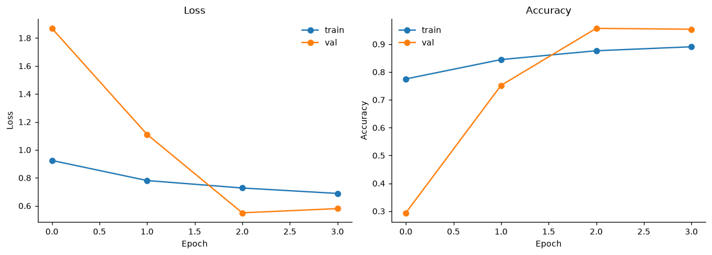
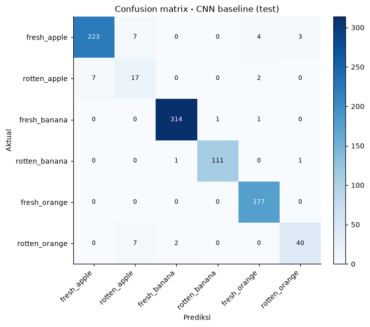
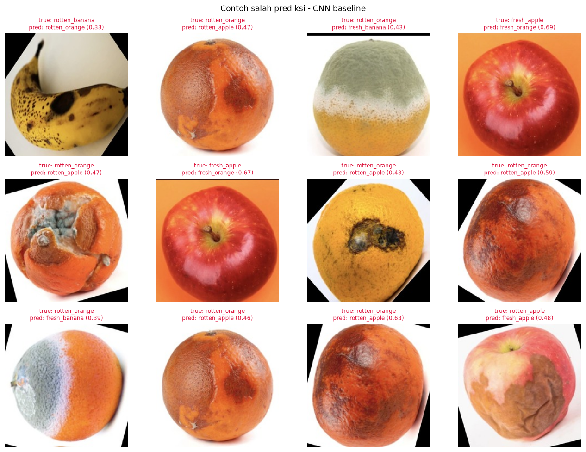
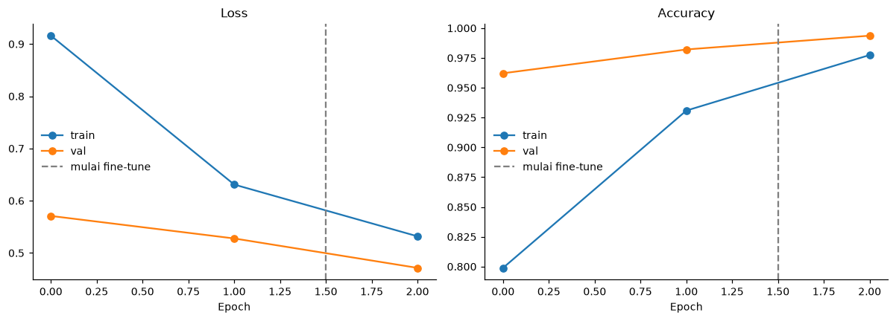
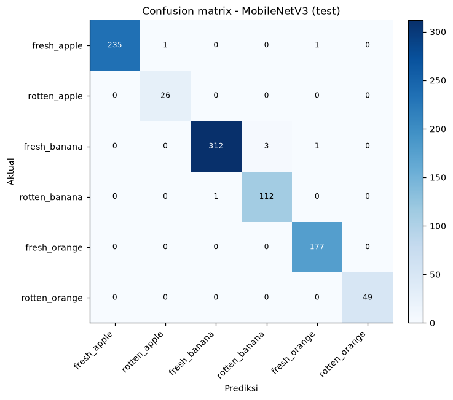
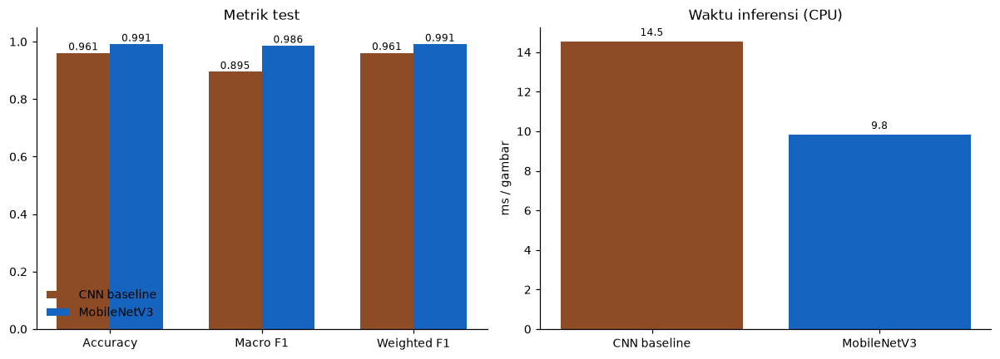
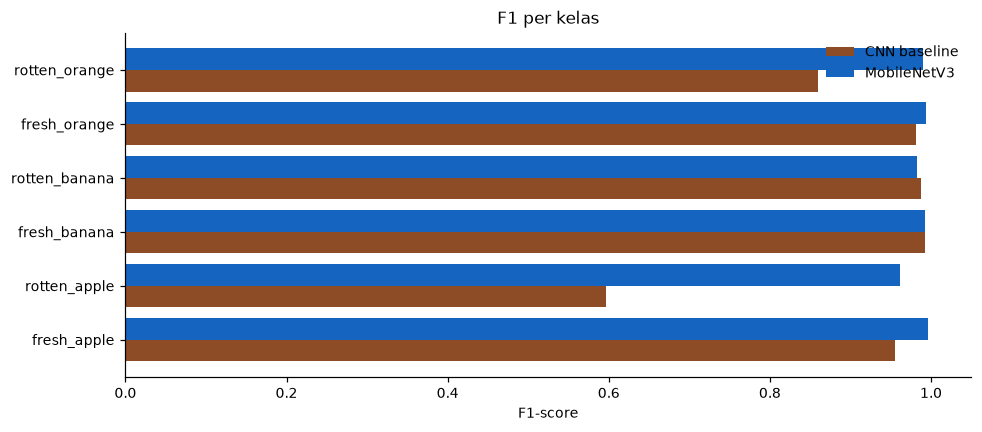
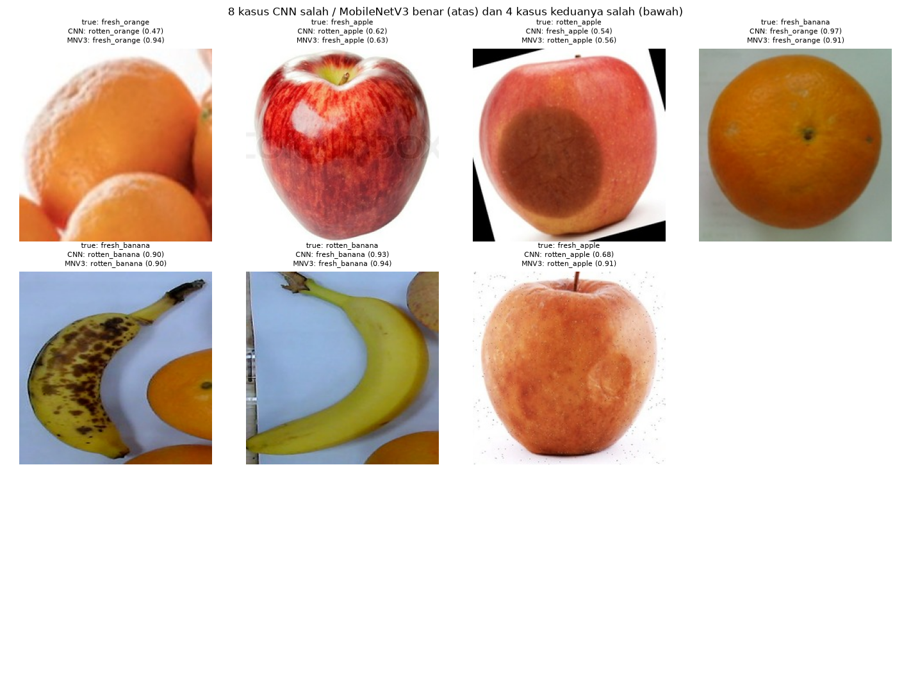
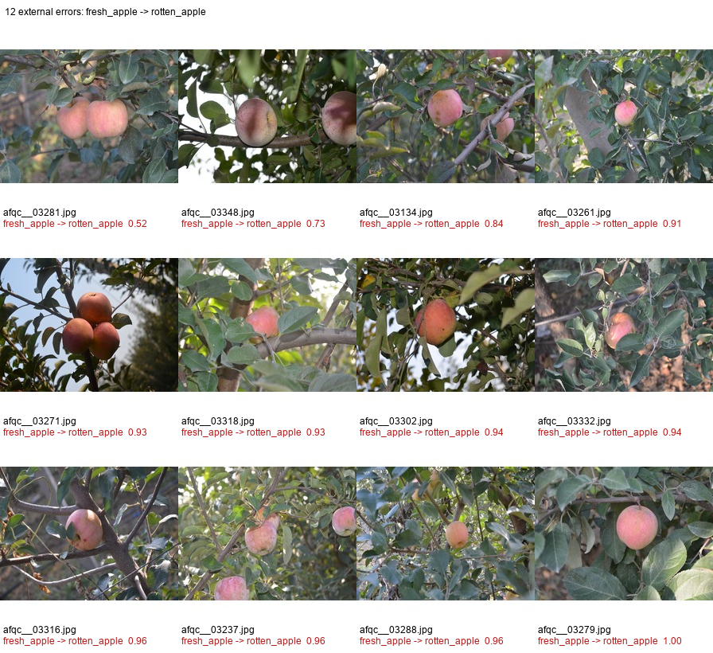
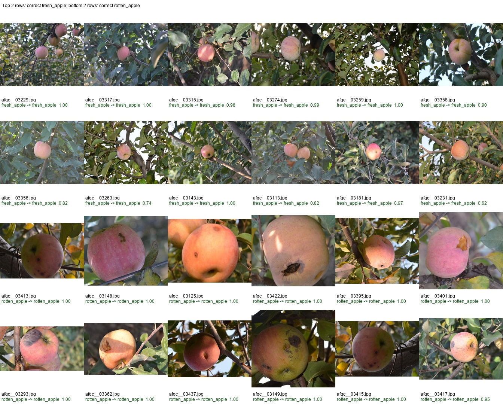

# FreshSight — Ringkasan Hasil

> Ringkasan statis dari artefak final di `reports_v2/` dan `models_v2/`.
> **Tidak perlu menjalankan notebook atau training ulang** untuk melihat isi file ini.
> Buka preview Markdown di VS Code (`Ctrl+Shift+V`).

## Dataset dan protokol

| Item | Nilai |
|---|---:|
| Total crop | 10.433 |
| Internal (6 kelas) | 6.977 |
| Split internal train / val / test | 5.107 / 952 / 918 |
| External (apel + pisang) | 3.456 |
| Split external train / val / test | 2.993 / 119 / 344 |
| Fresh / rotten | 6.825 / 3.608 |

- Split bersih level crop (dHash + gambar sumber); crop test tidak bocor ke train.
- 344 crop external adalah test held-out dan tidak dipakai untuk training.

## Hasil internal 918 crop

| Model | Accuracy | Macro F1 | Error | Parameter | Ukuran | Inferensi |
|---|---:|---:|---:|---:|---:|---:|
| CNN baseline 25 epoch | **99,24%** | 0,985 | 7 | 423.526 | 5,16 MB | 16,90 ms |
| MobileNetV3Small 10+15 | **99,24%** | **0,991** | 7 | 942.582 | 4,34 MB | 11,98 ms |

Keduanya benar **911/918**. Error yang sama 4, error unik 3 per model; MobileNet dipilih
sebagai model final karena macro F1 lebih tinggi, model lebih kecil, dan inferensi lebih cepat.

## F1 per kelas

| Kelas | F1 CNN | F1 MobileNet | Support |
|---|---:|---:|---:|
| `fresh_apple` | 0,994 | 0,996 | 237 |
| `rotten_apple` | 0,943 | 0,981 | 26 |
| `fresh_banana` | 0,995 | 0,992 | 316 |
| `rotten_banana` | 0,991 | 0,982 | 113 |
| `fresh_orange` | 0,994 | 0,994 | 177 |
| `rotten_orange` | 0,990 | 1,000 | 49 |

## Hasil eksternal 344 crop

| Tahap | Internal 918 | External 344 |
|---|---:|---:|
| MobileNetV3Small penuh | 99,24% | 61,34% |
| + external fine-tune | 88,78% | 95,64% |
| + recalibrated head (final) | 98,91% | **97,09%** |

- Model final: `models_v2/mobilenetv3small_external_recalibrated.keras`.
- Sisa 10 error external semuanya `fresh_apple → rotten_apple`.
- `05b_clean_calibration.json` adalah artefak historis/smoke, **bukan** hasil final.

## Gambar hasil

### CNN baseline

### MobileNetV3Small

### Perbandingan dan F1 per kelas

### Audit error external

## File mentah

- [03_cnn_baseline_metrics.json](03_cnn_baseline_metrics.json)
- [03_cnn_baseline_history.csv](03_cnn_baseline_history.csv)
- [04_mobilenetv3_metrics.json](04_mobilenetv3_metrics.json)
- [05_comparison.json](05_comparison.json)
- [10_head_recalibration.json](10_head_recalibration.json)
- [10_external_finetune.json](10_external_finetune.json)
